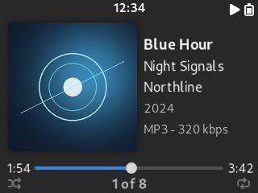
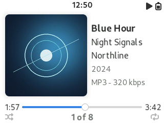
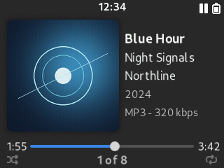

# Adwaitapod Focus

Adwaitapod Focus is a pair of 320 × 240 Rockbox themes based on Dook’s Adwaitapod Simplified. Both variants use the same Now Playing layout with their own light or dark menus, icons, and artwork. The screenshots were captured in the Rockbox iPod Classic (`ipod6g`) simulator.

| | Dark Focus | Light Focus |
| --- | --- | --- |
| Playing |  |  |
| Paused |  |  |

## Changes from Adwaitapod Simplified

- Now Playing centers the cover art vertically. The metadata block is centered beside it, with five left-aligned rows at 26-pixel baseline intervals.
- The track title uses 22-point Cantarell Bold. Album and artist use 20-point Cantarell Regular. The year and codec–bitrate use 18-point Cantarell Regular. The year row shows the first four characters of the date tag.
- The clock sits at the top. The play/pause status sits beside the battery with the loading spinner immediately to its left during disk activity. The large transport graphics and the footer divider are removed.
- The footer uses Adwaitapod Classic’s progress bar with elapsed and total time. The bar and thumb are vertically aligned with the time labels. The centered counter shows the current position in the active playlist and reappears after the volume overlay closes.

## Install on Rockbox

1. Choose [Dark Focus](adwaitapod_dark_focus) or [Light Focus](adwaitapod_light_focus).
2. Connect the iPod over USB. Copy the chosen theme’s hidden `.rockbox` folder to the root of the iPod drive and merge it with the existing `.rockbox` folder.
3. Safely eject the iPod. In Rockbox, open **Settings → Theme Settings → Browse Theme Files** and choose `adwaitapod_dark_focus` or `adwaitapod_light_focus`.

## Credits

Focus adapts Dook’s Adwaitapod Simplified and Classic skins. The upstream project retains the original themes. [Adwaitapod by Dook](https://github.com/D0-0K/adwaitapod)

See [LICENSE](adwaitapod_dark_focus/LICENSE) and [Licenses](adwaitapod_dark_focus/Licenses) for the upstream license files. Individual skins carry their original CC BY-SA attribution.
