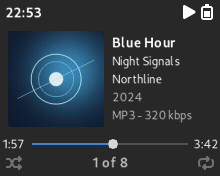
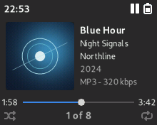
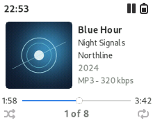

# Adwaitapod Focus

Adwaitapod Focus offers light and dark Rockbox themes based on Dook’s Adwaitapod Simplified. Each player has a shared Now Playing layout with light and dark palettes, icons, and artwork. The 320 × 240 screenshots below were captured in the Rockbox iPod Classic (`ipod6g`) simulator.

| | Dark Focus | Light Focus |
| --- | --- | --- |
| Playing |  |  |
| Paused |  |  |

## Sansa Fuze

The Sansa Fuze and Fuze v2 variants use a 220 × 176 Now Playing layout with 96 × 96 cover art and compact Cantarell text. Elapsed and total time sit at opposite screen edges, and the progress bar shortens to fit longer timestamps. The playlist counter, shuffle, and repeat indicators sit below the bar. These variants use the standard Rockbox menus with the Focus palette. The screenshots are from the Sansa Fuze simulator.

| | Dark Focus | Light Focus |
| --- | --- | --- |
| Playing |  |  |
| Paused |  |  |

## iPod Classic changes from Adwaitapod Simplified

- Now Playing centers the cover art vertically. The metadata block is centered beside it, with five left-aligned rows at 26-pixel baseline intervals.
- The track title uses 22-point Cantarell Bold. Album and artist use 20-point Cantarell Regular. The year and codec–bitrate use 18-point Cantarell Regular. The year row shows the first four characters of the date tag.
- The clock sits at the upper left, vertically aligned with the status icons. The play/pause status sits beside the battery with the loading spinner immediately to its left during disk activity. The large transport graphics and the footer divider are removed.
- The footer uses Adwaitapod Classic’s progress bar with elapsed and total time. The bar and thumb are vertically aligned with the time labels. The centered counter shows the current position in the active playlist and reappears after the volume overlay closes.

## Install on Rockbox

1. Choose your device’s theme.
   - iPod Classic · [Dark Focus](adwaitapod_dark_focus) or [Light Focus](adwaitapod_light_focus)
   - Sansa Fuze or Fuze v2 · [Dark Focus](adwaitapod_dark_focus_fuze) or [Light Focus](adwaitapod_light_focus_fuze)
2. Connect your player over USB. Copy the chosen theme’s hidden `.rockbox` folder to the root of the player’s drive and merge it with the existing `.rockbox` folder.
3. Safely eject the player. In Rockbox, open **Settings → Theme Settings → Browse Theme Files** and choose the installed theme. The Sansa Fuze variants end in `_fuze`.

## Credits

Focus adapts Dook’s Adwaitapod Simplified and Classic skins. The upstream project retains the original themes. [Adwaitapod by Dook](https://github.com/D0-0K/adwaitapod)

See [LICENSE](adwaitapod_dark_focus/LICENSE) and [Licenses](adwaitapod_dark_focus/Licenses) for the upstream license files. Individual skins carry their original CC BY-SA attribution.
